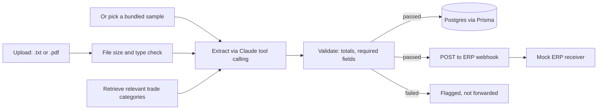

# Construction Document AI

A small, complete demo that turns construction invoices and tenders into
structured, trade-categorised, validated data, using Claude tool calling
grounded by a retrieval step, with an evaluation suite and a mock ERP
webhook integration.

This is a personal portfolio project built to demonstrate the architecture
pattern for construction-document AI workflows. It is not a product used by
a real construction company, and the sample vendors and figures in
`/samples` are invented for demonstration.

## Why this exists

The same shape of problem keeps showing up across different industries:
turn a semi-structured document into validated, structured data that a
downstream system can act on. I built this one specifically for
construction documents (invoices, tenders, quotes) after working on the
same pattern for invoice-to-ERP automation and healthcare document
extraction elsewhere, to have a direct example rather than an analogy.

## Architecture



## What is demonstrated, and where

| Requirement | Where |
|---|---|
| React, TypeScript, Tailwind | `app/page.tsx`, styled with Tailwind utility classes |
| Postgres | `prisma/schema.prisma`, read and write paths in `app/api/extract/route.ts` and `app/api/documents/route.ts` |
| Serverless functions | Next.js Route Handlers under `app/api/*/route.ts` |
| LLM tool calling | `lib/extraction-schema.ts` (the tool definition), `lib/claude-transport.ts` (`LiveClaudeTransport`) |
| Retrieval | `lib/retrieve-trade-context.ts`: scores the document against a trade-category glossary and injects the top matches into the Claude prompt, so categorisation is grounded in retrieved context rather than guessed |
| Evaluation | `evaluation/`: 10 scored cases across 6 dimensions, runnable with `npm run evaluate` |
| Guardrails and validation | `lib/validate-extraction.ts`: checks line-item totals, subtotal and tax consistency, and required fields before anything is forwarded |
| Integrating with an ERP via webhooks | `lib/erp-webhook.ts` and `app/api/mock-erp-webhook/route.ts` |
| Security basics | `lib/file-validation.ts` (5MB cap and MIME allowlist, checked before the upload body is read); raw document text is never logged |
| Testing | `lib/__tests__/*.test.ts`, run with `npm test` |

## Mock and live extraction

Extraction works out of the box with no API key, using a deterministic mock
transport (`lib/claude-transport.ts`) that parses the fixed line-item format
used by every file in `/samples`. This is a real rule-based extractor, not a
lookup of hardcoded answers: it genuinely fails on documents that do not
follow that layout, the same way a prompt tuned for one document shape needs
adjustment for another.

Set `ANTHROPIC_API_KEY` in `.env.local` to use the live transport instead,
which calls the real Claude API with tool calling and the same
retrieval-grounded prompt. Everything else in the app, the tests, and the
evaluation suite behaves identically either way.

## Running it locally

```bash
npm install
npx prisma generate

# Optional: start a local Postgres and run migrations if you want
# persistence; the app works without this too, it just will not save
# records.
npx prisma migrate dev

npm run dev
```

Open http://localhost:3000, pick a bundled sample document or upload your
own `.txt` or `.pdf`, and see the extracted line items, trade category
tags, and validation status. Submitting a validated record to "Send to ERP"
POSTs it to the bundled mock receiver so the full flow is visible end to
end with nothing external configured.

## Evaluation suite

```bash
npm run evaluate
```

Runs all 10 sample documents through the pipeline and scores each one
across six dimensions (vendor name, document number, line item count, grand
total, trade category assignment, and validation outcome), printing a
pass/fail breakdown per dimension rather than a single overall score. One
sample document has a deliberately incorrect subtotal, to prove the
validation guardrail catches a real inconsistency rather than always
passing.

## Scope boundaries, stated honestly

- PDF support extracts the text layer only (via `pdf-parse`), the same as a
  digitally produced invoice already containing selectable text. It does
  not perform image OCR on scanned documents or drawings; that would need a
  vision-capable step, a reasonable next extension but out of scope here.
- The mock transport's parser expects the pipe-delimited line item format
  used in `/samples`. The live Claude transport is far more tolerant of
  varied real-world document layouts, since it reads the raw text directly
  rather than relying on a fixed pattern.
- The ERP webhook integration is a mock receiver, since there is no real
  ERP to integrate against here. `ERP_WEBHOOK_URL` is a plain environment
  variable pointing at it; a production integration would add
  authentication headers specific to the target ERP.

## Testing and CI

```bash
npm run lint
npm run typecheck
npm test
npm run build
```

All of the above, plus the evaluation suite, run in GitHub Actions on every
push with zero secrets configured, since the mock transport means none of
it needs `ANTHROPIC_API_KEY`.
